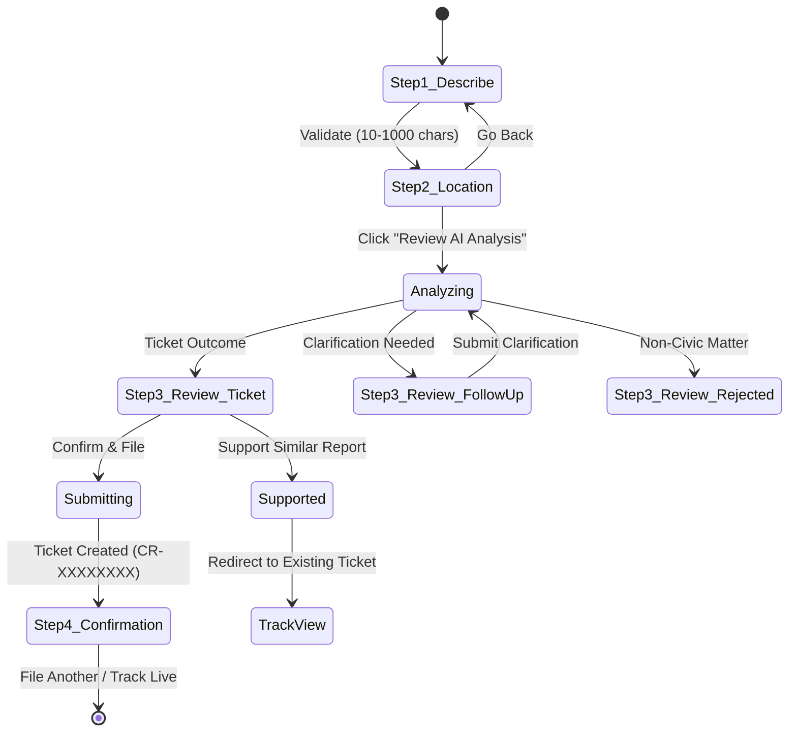

# CivicResolve Design System & UI Documentation

CivicResolve is designed for radical civic clarity, high speed, and universal accessibility (designed to WCAG 2.2 AA with automated contrast and axe checks).
The interface uses plain language (~8th-grade reading level), eliminates all technical municipal jargon, and provides immediate visual feedback.

---

## 1. Design Tokens

| Token | CSS Variable / Utility | Hex Value | Role / Usage |
| :--- | :--- | :--- | :--- |
| **Ink** | `var(--color-ink)` | `#0F172A` | Primary text, titles, headings, and high-emphasis labels. |
| **Surface** | `var(--color-surface)` | `#FFFFFF` | Cards, modals, dialogs, form backgrounds. |
| **Page** | `var(--color-page)` | `#F6F7F9` | Clean, low-glare app shell canvas. |
| **Border** | `var(--color-border)` | `#E2E8F0` | Structural dividers, card borders, subtle separators. |
| **Primary** | `var(--color-primary)` | `#1D4ED8` | Civic Blue: Primary CTAs, active stepper nodes, links. |
| **Accent** | `var(--color-accent)` | `#0F766E` | Forest Teal: Secondary actions, community support buttons. |
| **Radius SM** | `rounded-sm` | `8px` | Badges, pills, small tags. |
| **Radius MD** | `rounded-md` | `10px` | Standard buttons, input controls, chips. |
| **Radius LG** | `rounded-xl` | `12px` | Cards, modals, feature containers. |
| **Grid** | 8px spacing unit | Multiples of `0.5rem` | Rhythmic vertical and horizontal alignment. |
| **Shadow** | `shadow-subtle` | `0 1px 3px rgba(15,23,42,0.06)` | Single subtle depth elevation. |

---

## 2. WCAG 2.1 AA Contrast Ratio Verification

All text and interactive controls exceed W3C WCAG 2.1 AA requirements ($\ge 4.5:1$ for normal text, $\ge 3:1$ for UI controls):

| Element Pair | Foreground | Background | Contrast Ratio | WCAG 2.1 AA Status |
| :--- | :--- | :--- | :--- | :--- |
| **Reference: Black on white** | `#000000` | `#FFFFFF` | **21.00 : 1** | PASS (Exact reference) |
| **Reference: #767676 on white**| `#767676` | `#FFFFFF` | **4.54 : 1** | PASS (Exact reference) |
| **Body text on surface** | `#0F172A` | `#FFFFFF` | **17.85 : 1** | PASS ($\ge 4.5:1$) |
| **Body text on page** | `#0F172A` | `#F6F7F9` | **16.65 : 1** | PASS ($\ge 4.5:1$) |
| **Primary button text** | `#FFFFFF` | `#1D4ED8` | **6.70 : 1** | PASS ($\ge 4.5:1$) |
| **Accent button text** | `#FFFFFF` | `#0F766E` | **5.47 : 1** | PASS ($\ge 4.5:1$) |
| **Secondary text (slate-600) on white** | `#475569` | `#FFFFFF` | **7.58 : 1** | PASS ($\ge 4.5:1$) |
| **Secondary text (slate-600) on page** | `#475569` | `#F6F7F9` | **7.07 : 1** | PASS ($\ge 4.5:1$) |
| **Placeholder text (slate-500) on white** | `#64748B` | `#FFFFFF` | **4.76 : 1** | PASS ($\ge 4.5:1$) |
| **Link text (Primary blue) on white** | `#1D4ED8` | `#FFFFFF` | **6.70 : 1** | PASS ($\ge 4.5:1$) |
| **Teal accent text on white** | `#0F766E` | `#FFFFFF` | **5.47 : 1** | PASS ($\ge 4.5:1$) |
| **Urgency: Critical** | `#B91C1C` | `#FEF2F2` (8% tint) | **5.91 : 1** | PASS ($\ge 4.5:1$) |
| **Urgency: High** | `#C2410C` | `#FFF7ED` (8% tint) | **4.88 : 1** | PASS ($\ge 4.5:1$) |
| **Urgency: Medium** | `#A16207` | `#FEFCE8` (8% tint) | **4.76 : 1** | PASS ($\ge 4.5:1$) |
| **Urgency: Low** | `#475569` | `#F1F5F9` (8% tint) | **6.92 : 1** | PASS ($\ge 4.5:1$) |
| **Status: Submitted** | `#1D4ED8` | `#EFF6FF` (8% tint) | **6.16 : 1** | PASS ($\ge 4.5:1$) |
| **Status: Under Review** | `#6D28D9` | `#F5F3FF` (8% tint) | **6.48 : 1** | PASS ($\ge 4.5:1$) |
| **Status: Assigned** | `#0369A1` | `#F0F9FF` (8% tint) | **5.57 : 1** | PASS ($\ge 4.5:1$) |
| **Status: In Progress** | `#115E59` | `#F0FDFA` (8% tint) | **7.27 : 1** | PASS ($\ge 4.5:1$) |
| **Status: Resolved** | `#166534` | `#F0FDF4` (8% tint) | **6.81 : 1** | PASS ($\ge 4.5:1$) |
| **Status: Closed** | `#475569` | `#F8FAFC` (8% tint) | **7.24 : 1** | PASS ($\ge 4.5:1$) |
| **Status: Rejected** | `#991B1B` | `#FEF2F2` (8% tint) | **7.60 : 1** | PASS ($\ge 4.5:1$) |
| **Status: Reopened** | `#C2410C` | `#FFF7ED` (8% tint) | **4.88 : 1** | PASS ($\ge 4.5:1$) |
| **Focus Ring on white** | `#1D4ED8` | `#FFFFFF` | **6.70 : 1** | PASS ($\ge 3:1$) |
| **Focus Ring on page** | `#1D4ED8` | `#F6F7F9` | **6.25 : 1** | PASS ($\ge 3:1$) |
| **Form control border on white** | `#64748B` | `#FFFFFF` | **4.76 : 1** | PASS ($\ge 3:1$) |
| **Form control border on page** | `#64748B` | `#F6F7F9` | **4.44 : 1** | PASS ($\ge 3:1$) |
| **KPI Critical accent bar on white** | `#B91C1C` | `#FFFFFF` | **6.47 : 1** | PASS ($\ge 3:1$) |
| **KPI Overdue accent bar on white** | `#C2410C` | `#FFFFFF` | **5.18 : 1** | PASS ($\ge 3:1$) |
| **Selected row left accent bar on white**| `#1D4ED8` | `#FFFFFF` | **6.70 : 1** | PASS ($\ge 3:1$) |

> Every ratio is validated programmatically in `apps/web/src/styles/contrast.test.ts` using the strict W3C relative luminance linearisation formula.

---

## 3. Plain Language Citizen Dictionary

| Internal Taxonomy | Plain Citizen Label | Target Expectation / Plain Definition |
| :--- | :--- | :--- |
| **`urgency: critical`** | Immediate Danger | Threat to life or public hazard. Target SLA: 24 hours. |
| **`urgency: high`** | Urgent | Heavy public disruption, near schools or hospitals. Target SLA: 48 hours. |
| **`urgency: medium`** | Routine | Standard municipal maintenance. Target SLA: 96 hours. |
| **`urgency: low`** | Minor | Cosmetic or scheduled repair. Target SLA: 168 hours. |
| **`status: submitted`** | Received | Logged into city registry; awaiting triage dispatch. |
| **`status: under_review`**| Under Review | Inspected by ward engineering supervisor. |
| **`status: assigned`** | Assigned to Crew | Dispatched to municipal field gang or contractor. |
| **`status: in_progress`** | Work in Progress | Maintenance crew actively working on-site. |
| **`status: resolved`** | Resolved | Field repair completed and verified by supervisor. |
| **`status: closed`** | Closed | Completed and citizen confirmation window concluded. |
| **`status: rejected`** | Not Actionable | Non-civic issue outside municipal purview. |
| **`status: reopened`** | Reopened by Citizen | Reopened for re-inspection after unsatisfactory fix. |
| **`roads`** | Roads & Infrastructure | BBMP / PWD / Municipal Engineering Division. |
| **`sanitation`** | Sanitation & Waste | Solid Waste Management (SWM) / Health Inspector Wing. |
| **`public_lighting`** | Public Street Lighting | Electrical Engineering & Streetlight Wing. |
| **`water_sewerage`** | Water & Sewerage Board | BWSSB / DJB / Municipal Water Supply Board. |
| **`parks_horticulture`**| Parks & Horticulture | Tree Authority & Horticulture Department. |
| **`public_health_safety`**| Public Health & Safety | Disaster Management & Public Hazard Cell. |
| **`ward_office`** | Local Ward Nodal Office | Ward Secretariat / Assistant Revenue Officer (ARO). |

---

## 4. Component Catalog

- **`UrgencyBadge`**: Displays plain urgency level (`Immediate Danger`, `Urgent`, `Routine`, `Minor`) with semantic icon and accessible `role="status"`.
- **`StatusPill`**: Lifecycle status indicator with tinted backgrounds and accessible status announcements.
- **`CategoryChip`**: Category metadata tag with icon.
- **`Stepper`**: 4-step progress indicator for citizen intake (Describe -> Location -> Review -> Receipt) with `aria-current="step"`.
- **`Timeline`**: Chronological audit trail showing state changes, actor roles, ISO timestamps, and notes.
- **`Callout`**: Prominent informational or emergency boxes. Emergency notices feature `role="alert"` and prominent helpline 112 guidance.
- **`CopyButton`**: Accessible one-click copying for 8-character Crockford tracking codes with clipboard fallback and screen-reader `aria-live` feedback.
- **`FieldError`**: Accessible form field error messages tied to inputs via `aria-describedby`.
- **`ErrorSummary`**: Top-of-form error aggregation with `role="alert"` for form recovery.
- **`EmptyState` & `ErrorState`**: Clear zero-data and retryable failure screens.
- **`RoleDialog`**: Accessible modal allowing evaluators to switch between Citizen and Authority roles and configure the authority access code.
- **`ReopenDialog`**: Modal for reopening resolved grievances with mandatory explanatory feedback.

---

## 5. Citizen Report State Machine

---

## 6. Sample Inputs for Evaluator Verification

Use the following sample complaints on the `/report` form to test all domain rules and triage pathways.
You can also generate and verify this output anytime via `npm run demo:samples`.

### Evaluator Sample Evaluation Matrix (Generated from Mock Provider & Domain Rules)

| Scenario | Category | Urgency | Department | Outcome Kind | Emergency? | Applied Rules |
| :--- | :--- | :--- | :--- | :--- | :---: | :--- |
| **Pothole near School (Location Boost)** | `pothole` | `critical` | Roads & Infrastructure | `ticket` | No | R4_DUPLICATE_BOOST |
| **Life-Safety Hazard (112 Emergency Notice)** | `public_hazard` | `critical` | Public Health & Safety | `ticket` | YES (112) | None |
| **Vague Complaint (Follow-up Question)** | `-` | `-` | None | `follow_up` | No | Follow-up question generated |
| **Non-Civic Spam (Instant Rejection)** | `-` | `-` | None | `rejected` | No | This request does not appear to be a municipal civic issue. |
| **Mixed Civic Grievance (Multi-issue Redressal)** | `garbage` | `high` | Sanitation & Waste Management | `ticket` | No | R4_DUPLICATE_BOOST |
| **Prompt Injection Defense (Maintains Hazard Floor)** | `public_hazard` | `critical` | Public Health & Safety | `ticket` | YES (112) | None |

---

### Step-by-Step Evaluator Test Scenarios

| Scenario | Sample Input Description | Expected Outcome |
| :--- | :--- | :--- |
| **Standard Pothole** | `"Deep road crater on 100ft road near Indiranagar bus stop. Vehicles are skidding."` | **Ticket created** at High/Medium urgency, dispatched to Roads & Infrastructure. |
| **Sensitive Site Proximity** | Select coordinates `lat: 12.9719, lng: 77.6416` (near NPS School) with complaint text: `"Deep dangerous pothole right outside National Public School on 100ft Road, Ward 12. School buses and children are getting stuck."` | **Location Boost rule triggered**; urgency raised. |
| **Emergency Live Hazard** | `"Live wire hanging from electric pole sparking over pedestrian sidewalk on MG Road, Ward 8. Immediate risk of electrocution!"` | **Immediate Danger** detected; Emergency Notice (112) callout displayed; Urgency set to Critical. |
| **Ambiguous / Missing Info** | `"road is bad"` | **Follow-up question** generated by triage engine requesting specific issue details. |
| **Non-Civic Spam** | `"Buy cheap cryptocurrency now at http://spam.crypto.biz and visit http://promo-coins.io for free tokens!"` | **Transparently rejected** without model call. |
| **Duplicate Support** | File a report for `"pothole on 100ft road"` near Ward 12. | **Similar reports panel** highlights existing complaint; allows 1-click support instead of duplicate creation. |
